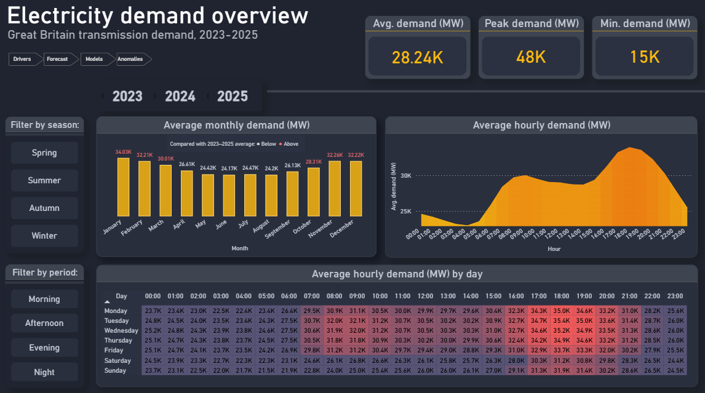
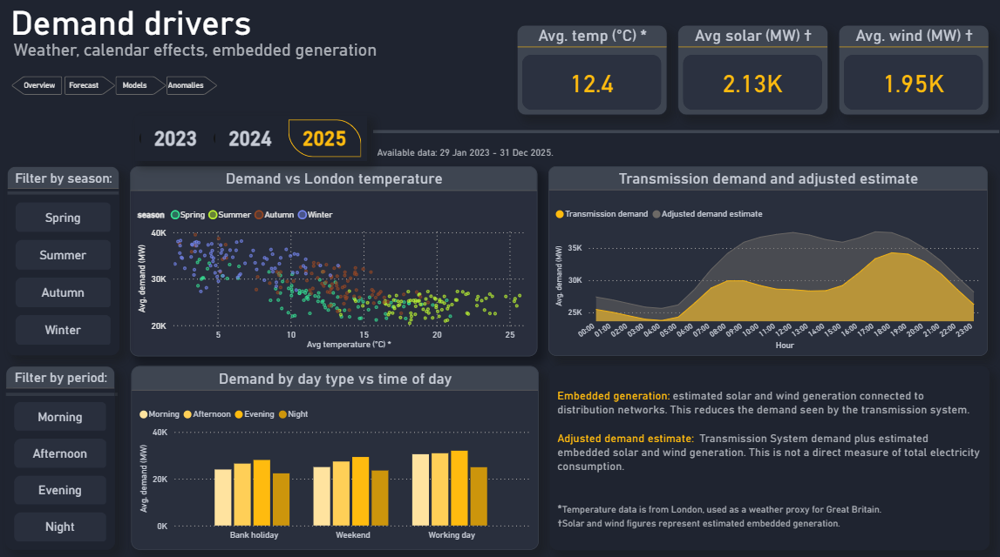
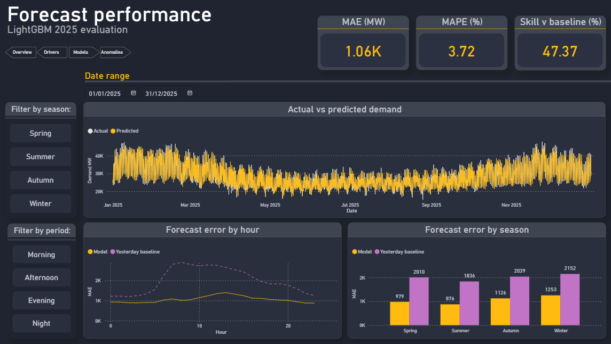
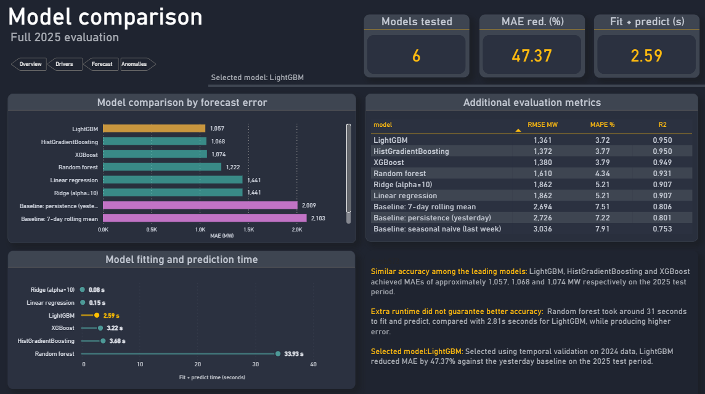
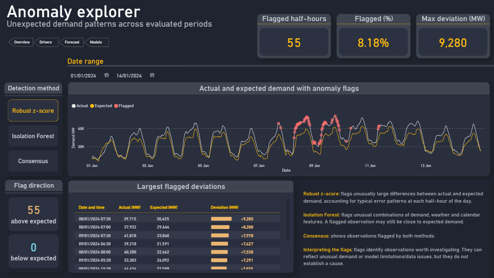

# Great Britain Electricity Demand: Forecasting and Anomaly Exploration

A portfolio project exploring half-hourly electricity demand in Great Britain, comparing prediction models and investigating unusual demand patterns. Python and SQLite prepare the data and run the analysis, a 5 page Power BI report makes the results interactive.

**Main result:** LightGBM reduced mean absolute error by **47.37%** against a yesterday-demand baseline on the 2025 evaluation data, with an MAE of **1,057 MW** and MAPE of **3.72%**.

The target is **Transmission System Demand (TSD)** in MW. The predictions use recorded weather, calendar info, embedded generation and pumping values for the same period. This is a historical prediction benchmark, using it for live forecasting would require inputs available at the forecast issue time.



## Project questions

- How does demand vary by season, day type and time of day?
- How are temperature and embedded generation associated with transmission demand?
- How much do machine-learning models improve on simple demand baselines?
- When are prediction errors largest, and which observations deserve investigation?

## Results

6 regression models and 3 baselines were evaluated. Model selection used the average MAE across four quarters of 2024, with training data expanding before each validation quarter. The selected configuration was then fitted on the available pre-2025 data and evaluated on 17,510 half-hours in 2025.

| Model | MAE (MW) | RMSE (MW) | MAPE (%) |
| --- | ---: | ---: | ---: |
| **LightGBM — selected** | **1,057** | **1,361** | **3.72** |
| HistGradientBoosting | 1,068 | 1,372 | 3.77 |
| XGBoost | 1,074 | 1,380 | 3.79 |
| Random forest | 1,222 | 1,610 | 4.34 |
| Linear regression | 1,441 | 1,862 | 5.21 |
| Ridge regression | 1,441 | 1,862 | 5.21 |
| Yesterday demand | 2,009 | 2,726 | 7.22 |
| 7-day rolling mean | 2,103 | 2,694 | 7.51 |
| Same period last week | 2,261 | 3,036 | 7.91 |

The leading 3 models produced similar errors. LightGBM's recorded fit-and-predict time was **2.59 seconds** in the latest run, timings depend on the machine and workload. The full results are in [model_comparison.csv](data/processed/model_comparison.csv).

The demand charts show higher winter demand and a pronounced evening peak. The analysis also explores differences between working days, weekends, bank holidays, alongside associations with London temperature and embedded generation.

### Anomaly exploration

5 expanding training rounds produced predictions for **42,700 half-hours**, covering 26 July 2023 to 31 December 2025. Each round trained on observations preceding its prediction period.

| Method | Flagged half-hours | Share evaluated |
| --- | ---: | ---: |
| Robust z-score by settlement period | 166 | 0.389% |
| Isolation Forest | 214 | 0.501% |
| Both methods (consensus) | 24 | 0.056% |

Together, the methods flagged **356 distinct half-hours**. The robust method's consecutive flags formed **52 groups**. The two methods look for different patterns: unusually large residuals for the time of day, and unusual combinations of demand, weather and calendar inputs. Flags are prompts for investigation, not confirmed faults or explanations of their causes.

## Power BI report

Open [energy_demand_report.pbix](powerbi/energy_demand_report.pbix) in Power BI Desktop. The report includes navigation buttons, date and seasonal filters, tooltips, and custom Deneb visuals.

| Page | Purpose |
| --- | --- |
| Electricity demand overview | Monthly patterns, daily profiles, weekday/hour heatmap |
| Demand drivers | Temperature, day types, embedded generation |
| Forecast performance | Actual versus predicted demand and errors by hour and season |
| Model comparison | Accuracy, recorded runtime, model-selection interpretation |
| Anomaly explorer | Detection methods, flag direction, largest deviations |

Screenshots show example filter selections, their cards do not always represent the full dataset.

<details>
<summary>View the remaining dashboard pages</summary>

### Demand drivers



### Forecast performance



### Model comparison




### Anomaly explorer



</details>

## Data and workflow

Demand and generation data cover 2023–2025. After creating historical features and removing rows missing required model inputs, 51,234 observations and 41 inputs are available for modelling, starting on 29 January 2023.

| Input | Source used in this project |
| --- | --- |
| Transmission demand, embedded solar/wind and pumping | NESO demand-data CSVs for 2023, 2024, 2025 |
| London hourly weather | Open-Meteo historical weather API |
| England and Wales bank holidays | GOV.UK bank-holiday JSON snapshot |
| School holidays | Manually prepared approximate holiday periods |

Download endpoints and parameters are recorded in [Notebook 1](notebooks/01_data_collection.ipynb). The original snapshots are needed to reproduce the recorded results exactly, downloading again may return revised data or different holiday coverage.

The workflow uses SQL to build a relational database and create demand lags, rolling statistics, calendar indicators and weather features. Python handles exploration, temporal validation, model comparison, feature importance and anomaly detection. The final notebook exports fact and dimension tables for Power BI.

## Run the project

Developed with **Python 3.11.7**. Package versions are pinned in [requirements.txt](requirements.txt). 

### 1. Set up Python

From the project root, create an environment and install dependencies. On Windows:

```powershell
py -3.11 -m venv .venv
.venv\Scripts\python.exe -m pip install -r requirements.txt
```

Open the project in VS Code with the Python and Jupyter extensions, then select `.venv` as the notebook kernel. The requirements include `ipykernel`; they do not install the standalone JupyterLab interface.

### 2. Prepare the raw files

Place these files in `data/raw/`:

- `demanddata_2023.csv`
- `demanddata_2024.csv`
- `demanddata_2025.csv`
- `weather_london_2023_2025.csv`
- `bank_holidays.csv`
- `school_holidays.csv`

Notebook 1 downloads the demand, weather and bank-holiday files. It does not create the manually prepared school_holiday CSV. Retain that file and use the original data snapshots when reproducing the published results. Skip Notebook 1 if the raw files are already available.

### 3. Run the notebooks in order

Restart the kernel and run all cells in each notebook before continuing.

| Notebook | Output |
| --- | --- |
| [1 - Data collection](notebooks/01_data_collection.ipynb) | Downloaded raw data, if needed |
| [2 - Database building](notebooks/2_database_building.ipynb) | SQLite tables populated from raw files |
| [3 - Feature engineering](notebooks/3_feature_engineering.ipynb) | SQL feature table and CSV/Parquet exports |
| [4 - Exploratory analysis](notebooks/4_EDA.ipynb) | Demand-pattern figures |
| [5 - Modelling](notebooks/5_modelling.ipynb) | Evaluation results, selected model and metadata |
| [6 - Anomaly detection](notebooks/6_adv_modelling_anomaly_detection.ipynb) | Historical predictions, flags and consecutive groups |
| [7 - Power BI export](notebooks/7_powerbi_export.ipynb) | Dashboard data tables |

Notebook 2 rebuilds database tables, including saved predictions and anomaly flags. Run the remaining notebooks afterwards to regenerate the outputs. Paths support execution from the project root or the `notebooks` directory.

### 4. Refresh Power BI

The report's CSV connections use local paths. Update the sources to your project location before refreshing: most tables read from `powerbi/data/`, while `fct_anomaly_evaluation` reads `data/processed/residuals.csv`. In Power Query, inspect each query's Source step and change the file path where needed. Apply the changes and refresh the report.

## Project structure

| Folder | Contents |
| --- | --- |
| `notebooks/` | Seven analysis and export notebooks |
| `sql/` | Database schema and feature-engineering queries |
| `data/raw/` | Source snapshots and manually prepared holidays |
| `data/processed/` | Features, scores, predictions and anomaly summaries |
| `database/` | Generated SQLite database |
| `models/` | Saved LightGBM model and selection metadata |
| `figures/` | Notebook charts |
| `powerbi/` | Final report and exported dashboard data |
| `docs/images/` | Dashboard screenshots for this README |

## Interpretation and limitations

- **Scope:** TSD measures demand on Great Britain's transmission system. It is not total UK energy use. Adding embedded solar and wind produces an adjusted estimate, not a direct measurement of total electricity consumption.
- **Input availability:** The benchmark uses observed conditions for the predicted period. A deployment would need suitable forecast inputs and a clearly defined prediction horizon.
- **Evaluation history:** The revised selection procedure uses 2024 validation, but 2025 results had already been inspected during development. The 2025 period is therefore not an untouched final holdout.
- **Geographic proxies:** London weather represents wider weather conditions. England and Wales bank holidays and approximate school holidays do not capture every regional difference.
- **Clock changes:** Modelling and dashboard exports use periods 1–48 and nominal half-hour timestamps. They omit periods 49–50 and do not fully represent local clock time on daylight-saving transition days.
- **Anomaly interpretation:** The selected 2024 model configuration is reused for earlier prediction periods, and detectors are fitted across the historical analysis sample. This is retrospective exploration. There are no verified anomaly labels with which to measure detection accuracy.
- **Feature importance:** Shuffling inputs measures the fitted model's reliance on them. Related inputs can share information, and importance does not establish cause and effect.

## Possible extensions

Evaluating a defined day-ahead forecasting task using only inputs available at issue time, introducing geographically representative weather, handling settlement timestamps across clock changes,  evaluating forecast intervals and anomaly flags against independently documented events.
